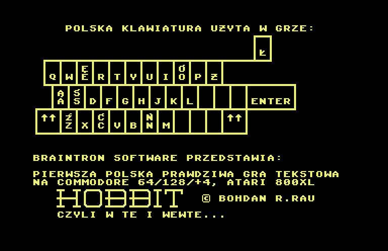
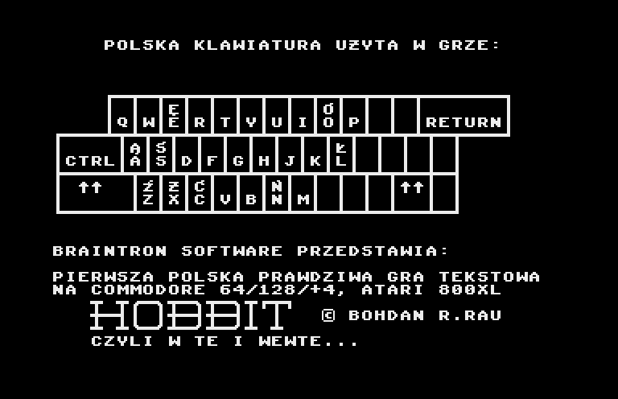
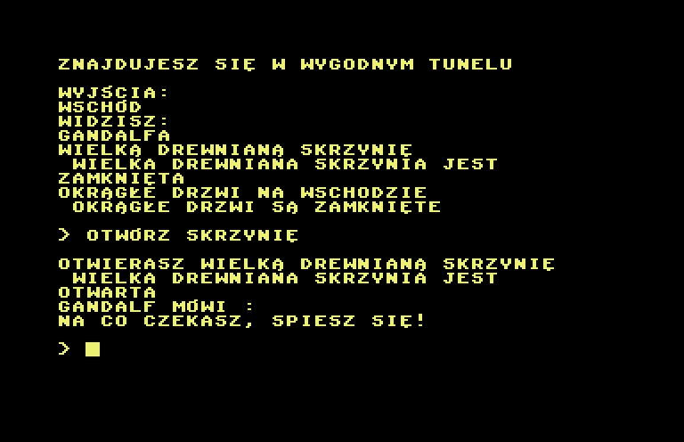
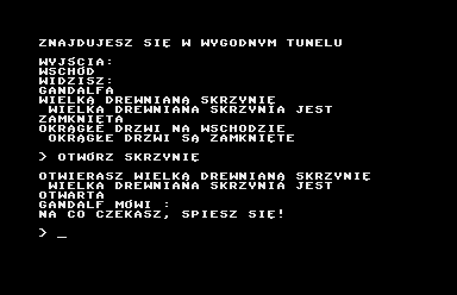
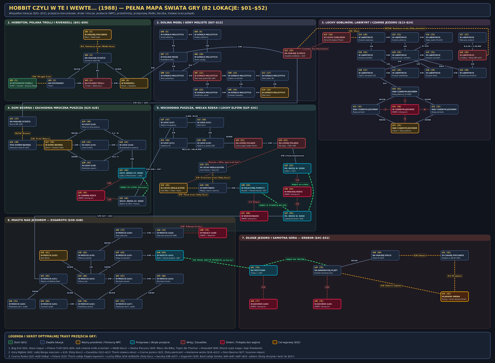

# Hobbit czyli w te i wewte... (C64 & Atari 800XL/XE Unified Source)

Full symbolic disassembly of **Bohdan R. Rau's** 1988 Polish text adventure **_Hobbit czyli w te i wewte..._** (*Braintron Software*), structured so that a **single unified 6502 assembly source** (`src/hobbit.asm`) compiles with [Mad-Assembler (MADS)](https://mads.atari8.info/) into:

1. **`build/hobbit.prg` (Commodore 64):** **100% byte-for-byte identical** to the original 1988 C64 binary (`24,164` bytes, MD5 `96b2f853e9dc196a9a8cb572415e5bc9`).
2. **`build/hobbit.xex` (Atari 800XL/XE):** Native Atari XL/XE executable built by switching the platform macro definitions (`-d:TARGET_ATARI=1`), demonstrating the cross-platform macro technique described by Bohdan R. Rau (`RAMON`, `ROMON`, `INCPTR`, and OS/hardware I/O wrappers).
3. **`build/hobbit.atr` (Atari 800XL/XE Floppy Image):** Bootable 90 KB single-density Atari DOS 2.5 floppy disk containing `DOS.SYS`, `DUP.SYS`, and `build/hobbit.xex` as `AUTORUN.SYS`, supporting persistent floppy disk save/load (`D:HOBBIDATA`).

---

## Screenshots

| Commodore 64 (`build/hobbit.prg`) | Atari 800XL/XE (`build/hobbit.atr`) |
| :---: | :---: |
|  |  |
|  |  |

### World Map (`$01`–`$52`)



---

## Building

Requires `mads` (Mad-Assembler) in `PATH` and `python3`:

```bash
# Build C64 (build/hobbit.prg) and Atari XL/XE (build/hobbit.xex + build/hobbit.atr)
make

# Verify that build/hobbit.prg matches the original 1988 C64 binary MD5 checksum
make check
```

---

## Repository Structure

| File | Description |
| :--- | :--- |
| `src/hobbit.asm` | Common platform-independent disassembly of the game (`$0801–$6419`), including the 8×8 Polish font, two-stage bootstrap, dictionary/room/object tables, and Polish inflection parser. |
| `src/c64.inc` | Commodore 64 platform definitions & macros (`PROGRAM_HEADER`, `END_LOW_RAM_SEGMENT`, `PROGRAM_FOOTER`, `RAMON`, `ROMON`, `INCPTR`, `INIT_HARDWARE`, `BANK_READ_IMPL`, KERNAL I/O wrappers, and zero-page pointers `$61–$62`, `$69–$6C`). |
| `src/atari.inc` | Atari 800XL/XE platform definitions, macros & compatibility layer: zero-page pointers (`$E0–$EB`), 40×25 ANTIC Mode 2 Display List using the original C64 Polish font at `$0800–$0BFF`, PIA `PORTB` (`$D301`) banking for `$C000–$CFFF` RAM, low-RAM relocation/swapping (`$0800–$1FFF` ↔ `$7000–$87FF`) to coexist with Atari DOS 2.5, PETSCII-to-screen-code console driver, POKEY Polish keyboard lookup tables, and DOS 2.5 CIO (`D:HOBBIDATA`) + in-memory (`$A800`) save/load. |
| `tools/mk_atr.py` | Builds `build/hobbit.atr` containing Atari DOS 2.5 (`tools/dos25/`) and `build/hobbit.xex` as `AUTORUN.SYS`. |
| `tools/test_save_load.py` | Automated 6502 unit tests verifying disk (`D:HOBBIDATA`) and cassette (`C:`) save/load round-trips and error handling. |
| `tools/gen_map.py` | Generates the complete 82-room world map (`screenshots/map.png`) using PyCairo. |
| `screenshots/map.png` | Full visual world map of all 82 locations (`$01`–`$52`), directional exits, doors/keys, NPCs, items, and traps. |
| `SOLUTION.md` | Complete step-by-step walkthrough and puzzle guide for *Hobbit czyli w te i wewte...* (in English). |
| `SOLUTION_PL.md` | Polish walkthrough (`Opis przejścia`), full verbatim game transcript, and complete database of all 82 locations, 53 objects/NPCs, and character dialogues. |
| `Makefile` | Builds `build/hobbit.prg`, `build/hobbit.xex`, and `build/hobbit.atr`, and verifies `checksum.md5`. |
| `checksum.md5` | MD5 checksum of the original 1988 C64 `hobbit.prg`. |

---

## How Cross-Platform Compilation Works

The original game engine (`$2D80–$59DF`) was written in pure 6502 assembly with almost no direct hardware dependencies:

1. **RAM Banking (`RAMON` / `ROMON` & `BANK_READ_IMPL`):**
   - **C64:** Toggles the 6510 CPU port at `$01` (saving to `port_save` at `$2D91`) to expose RAM under the BASIC ROM (`$B000` active object table) and KERNAL/I/O (`$C000–$CC83` Polish inflection & room exit tables).
   - **Atari 800XL/XE:** Disables BASIC ROM (`$A000–$BFFF`) via `PORTB` (`$D301` bit 1 = 1) at startup, and toggles `PORTB` bit 0 (with NMI/IRQ masked) in `atari_ramon` / `atari_romon` to access the dictionary and room tables in RAM under the Atari OS ROM at `$C000–$CFFF`.
2. **Zero-Page Pointers (`ZP_61..ZP_6C` & `INCPTR`):**
   - **C64:** Uses `$61–$62` and `$69–$6C`.
   - **Atari 800XL/XE:** Relocates these 6 bytes to `$E0–$E1` and `$E8–$EB` so Atari OS zero-page variables (`$00–$7F`) used by VBI/CIO remain untouched.
3. **Display & Polish Character Set (`INIT_HARDWARE` & `CHROUT`):**
   - The original 128-character 8×8 custom font resides at `$0800–$0BFF` (restored by `boot_stage2` from `$0C00–$0CFF`).
   - On **Atari 800XL/XE**, ANTIC's character base register (`CHBAS` `$02F4` / `CHBASE` `$D409`) points directly to `$08` (`$0800–$0BFF`), and an ANTIC Mode 2 Display List provides a 25-row × 40-column screen at `$BC00–$BFE7`, rendering the exact same Polish glyphs (`Ą, Ć, Ę, Ł, Ń, Ó, Ś, Ź, Ż`), `HOBBIT` logo, and keyboard diagram as the C64 version.
4. **Polish Keyboard Input on Atari (`GETIN`):**
   - Standard letters `A–Z`, digits `0–9`, `SPACE`, `RETURN`, and `BACKSPACE` work normally.
   - Polish diacritics are typed using **`Ctrl` + letter** as shown on the Atari title-screen keyboard diagram:
     - `Ctrl + A` → **Ą**
     - `Ctrl + C` → **Ć**
     - `Ctrl + E` → **Ę**
     - `Ctrl + L` → **Ł**
     - `Ctrl + N` → **Ń**
     - `Ctrl + O` → **Ó**
     - `Ctrl + S` → **Ś**
     - `Ctrl + Z` → **Ź**
     - `Ctrl + X` → **Ż**
