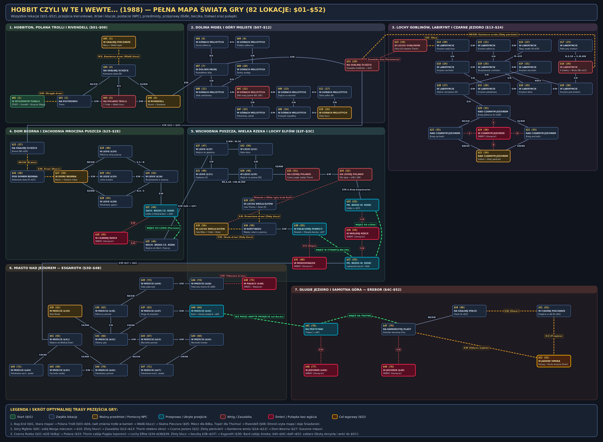

# Hobbit czyli w te i wewte... — Complete Solution (Walkthrough)

Complete, emulator-verified walkthrough for **Bohdan R. Rau's** 1988 Polish text adventure **_Hobbit czyli w te i wewte..._** (*Braintron Software*), verified directly against the symbolic disassembly in [`src/hobbit.asm`](src/hobbit.asm).

---

## World Map (All 82 Locations: `$01`–`$52`)



### Regional Route Overview

```mermaid
flowchart LR
    subgraph R1["1. Hobbiton & Trollshaws ($01-$06)"]
        L01["$01 Bag End<br/>(Start, Map, Goal)"] <-->|"E/W (Round Door)"| L02["$02 Wasteland<br/>(Thorin)"]
        L02 <-->|"E/W"| L03["$03 Trolls' Clearing<br/>(Large Key)"]
        L03 <-->|"N/S"| L04["$04 Rocky Path"]
        L04 <-->|"N/S (Large Key)"| L05["$05 Rocky Cave<br/>(Sword, Axe)"]
        L03 <-->|"E/W"| L06["$06 Rivendell<br/>(Elrond -> Breakfast)"]
    end

    subgraph R2["2. Misty Mountains ($07-$12)"]
        L06 <-->|"E/W"| L07["$07 Valley of Mists"]
        L07 <-->|"S/N"| L0C["$0B-$0F Misty Mountains<br/>(Wild Warg)"]
        L0C <-->|"D/U"| L10["$10-$11 Lower Ledge<br/>(Golden Key)"]
        L07 <-->|"E/W"| L12["$12 Rocky Path"]
    end

    subgraph R3["3. Goblin Dungeons & Lake ($13-$24)"]
        L12 -.->|"Ambush (no Ring)"| L13["$13 Goblin Dungeon"]
        L13 <-->|"U/D (Window - Thorin)"| L14["$14-$1F Labyrinth"]
        L14 <-->|"D/U"| L20["$20-$23 Black Lake<br/>($22: Golden Ring)"]
        L14 <-->|"NE/SW (Stone Gate)"| L12
    end

    subgraph R4["4. Beorn's House & Black River ($25-$2E)"]
        L12 <-->|"E/W"| L25["$25-$26 Courtyard"]
        L25 <-->|"E/W (Door - Beorn)"| L27["$27 Beorn's House<br/>(Dried Meat)"]
        L27 <-->|"E/W"| L2C["$28-$2C West Bank"]
        L2C <-->|"Boat (with Ring)"| L2E["$2E East Bank"]
    end

    subgraph R5["5. Mirkwood & Elven Dungeons ($2F-$3C)"]
        L2E <-->|"E/W"| L33["$2F-$33 Clearing<br/>(Black Spider)"]
        L33 <-->|"E/W"| L34["$34 Clearing"]
        L34 -.->|"Captured (no Crystal Ball)"| L38["$38-$3B Elven Dungeons<br/>(Golden Key, Bread)"]
        L38 -->|"Open Barrel"| L37["$37 South Bank"]
        L34 <-->|"E/W (with Crystal Ball)"| L35["$35 North Bank"]
        L35 <-->|"Boat"| L37
    end

    subgraph R6["6. Lake-town Esgaroth ($3D-$4B)"]
        L37 <-->|"E/W"| L41["$3D-$4A Lake-town<br/>(Bard -> slays Dragon)"]
        L41 -->|"Hidden Passage ($40)"| L4C["$4C Pier"]
    end

    subgraph R7["7. Lonely Mountain ($4C-$52)"]
        L4C <-->|"Raft"| L4F["$4F Stony Beach"]
        L4F <-->|"E/W or NE->E->D"| L52["$52 Dragon's Lair<br/>(Iron-bound Chest + Crystal Ball)"]
    end
```



---

## 1. Abbreviations & Engine Mechanics

### Direction & Action Shortcuts (`abbrev_str_table`)
| Shortcut | Expanded Command | Meaning |
| :--- | :--- | :--- |
| `PN` | `IDŹ NA PÓŁNOC` | Go North |
| `PNW` | `IDŹ NA PÓŁNOCNY WSCHÓD` | Go Northeast |
| `W` | `IDŹ NA WSCHÓD` | Go East |
| `PDW` | `IDŹ NA POŁUDNIOWY WSCHÓD` | Go Southeast |
| `PD` | `IDŹ NA POŁUDNIE` | Go South |
| `PDZ` | `IDŹ NA POŁUDNIOWY ZACHÓD` | Go Southwest |
| `Z` | `IDŹ NA ZACHÓD` | Go West |
| `PNZ` | `IDŹ NA PÓŁNOCNY ZACHÓD` | Go Northwest |
| `G` | `IDŹ W GÓRĘ` | Go Up |
| `D` | `IDŹ W DÓŁ` | Go Down |
| `C` | `CZEKAJ` | Wait one turn |
| `POKAŻ` | `POKAŻ` | Show carried items (inventory) |
| `NAGRAJ` / `SAVE` | `NAGRAJ` | Save game state to tape (`T`) or disk (`D`) |
| `ZAKOŃCZ` | `ZAKOŃCZ` | Quit / restart game |

### Important Parser & Gameplay Rules
1. **Combat Requires Naming the Weapon:**
   When attacking an enemy (or ordering an NPC to attack), you **must** specify the weapon in the Polish instrumental case (`Narzędnik`):
   * `ZABIJ WARGA MIECZEM`
   * `POWIEDZ THORINOWI ZABIJ PAJĄKA TOPOREM`
   Attacking without naming the weapon (`ZABIJ WARGA`) always results in defeat (`WALKA JEST ZACIĘTA, ALE JESTEŚ ZBYT SŁABY...`).
2. **Giving Items Before Asking NPCs to Use Them:**
   An NPC can only interact with an object that is either in the current room or in that NPC's own inventory. Before asking Elrond to read `STARA MAPA`, give it to him (`DAJ MAPĘ ELRONDOWI`) or drop it (`ZOSTAW MAPĘ`).
3. **Hunger & Provisions (`update_hunger_and_carry`):**
   You begin the game with `180` turns before starving (`GINIE Z GŁODU`). Eating any of the three food items in the game resets your hunger counter to the maximum (`255` turns):
   * `ŚNIADANIE` (given by Elrond in Rivendell)
   * `SUSZONE MIĘSO` (given by Beorn in his house)
   * `CHLEB` (found in the Wood-Elves' dungeon)

---

## 2. Step-by-Step Walkthrough

### Stage 1: Bag End & The Trolls (Rooms `$01`–`$05`)
You start in your hobbit-hole (`W WYGODNYM TUNELU`, Room `$01`) with Gandalf.

1. `OTWÓRZ SKRZYNIĘ` — opens the large wooden chest (`WIELKA DREWNIANA SKRZYNIA`).
2. `WEŹ MAPĘ` — takes the old map (`STARA MAPA`).
3. `OTWÓRZ DRZWI` — opens the round door (`OKRĄGŁE DRZWI`; Thorin may also open it from outside and walk in).
4. `W` — go East to the wasteland (`NA PUSTKOWIU`, Room `$02`). Thorin joins you and follows you from room to room.
5. `W` — go East to the trolls' clearing (`NA POLANIE TROLLI`, Room `$03`).
   > **Trap:** Two trolls (`STARY DZIKI TROLL` and `MŁODY DZIKI TROLL`) spot you (`ZOBACZ, WILL, WESZŁO ŚNIADANIE!`). If you remain in Room `$03` for another turn, they eat you.
6. `PN` — immediately flee North to the rocky path (`NA SKALNEJ ŚCIEŻCE`, Room `$04`).
7. `C` — wait one turn. Dawn breaks (`WSTAJE DZIEŃ...`), turning both trolls to stone and dropping the Large Key (`WIELKI KLUCZ`) in Room `$03`.
8. `PD` — return South to the trolls' clearing (`NA POLANIE TROLLI`, Room `$03`).
9. `WEŹ KLUCZ` — pick up `WIELKI KLUCZ`.
10. `PN` — go North back to `NA SKALNEJ ŚCIEŻCE` (Room `$04`).
11. `OTWÓRZ DRZWI` — unlocks and opens the stone door (`KAMIENNE DRZWI`) using `WIELKI KLUCZ`.
12. `ZOSTAW KLUCZ` — drop the key (no longer needed).
13. `PN` — enter the trolls' cave (`W SKALNEJ PIECZARZE`, Room `$05`). When Thorin enters, he automatically takes the Great Axe (`THORIN ZABIERA WIELKI TOPÓR`).
14. `WEŹ MIECZ` — take the sword (`MIECZ`).

---

### Stage 2: Rivendell & The Misty Mountains (Rooms `$06`–`$11`)
1. `PD` — leave the cave back to `NA SKALNEJ ŚCIEŻCE` (Room `$04`).
2. `PDW` — go Southeast to Rivendell (`W RIVENDELL`, Room `$06`), where `ELROND` is waiting.
3. `DAJ MAPĘ ELRONDOWI` — give `STARA MAPA` to Elrond.
4. `POWIEDZ ELRONDOWI PRZECZYTAJ MAPĘ` — Elrond translates the ancient script (`SZUKAJ NA POŁUDNIE OD DOLINY MGIEŁ`) and gives you breakfast (`ELROND DAJE CI ŚNIADANIE`).
5. `W` — go East to the Valley of Mist (`W DOLINIE MGIEŁ`, Room `$07`).
6. `PD` — go South into the Misty Mountains (`W GÓRACH MGLISTYCH`, Room `$0B`).
7. `PD` — go South again (Room `$0C`).
   > **Combat:** A Wild Warg (`DZIKI WARG`) patrols Rooms `$0C`–`$0F` and blocks your exit (`WARG NIE POZWALA CI ODEJŚĆ`). If the Warg is not yet in Room `$0C`, wait (`C` 1–2 times) until `WCHODZI DZIKI WARG`.
8. `ZABIJ WARGA MIECZEM` — slays the Wild Warg with your sword.
9. `ZOSTAW MIECZ` — drop the sword (no longer needed).
10. `W` — go East (Room `$0D`).
11. `D` — go Down (Room `$11`).
12. `PD` — go South (Room `$10`), where the Golden Key (`ZŁOTY KLUCZ`) lies.
13. `WEŹ KLUCZ` — take `ZŁOTY KLUCZ` (needed later to escape the Wood-Elves' dungeon).
14. `PN`, then `G`, then `Z`, then `PN`, then `PN` — return to the Valley of Mist (`W DOLINIE MGIEŁ`, Room `$07`).

---

### Stage 3: Goblin Dungeon, Labyrinth & Gollum's Ring (Rooms `$12`–`$23`)
1. `W` — go East onto the rocky path (`NA SKALNEJ ŚCIEŻCE`, Room `$12`). Goblins ambush and capture you (`NAGLE POJAWIAJĄ SIĘ GOBLINY...`), placing you in the Goblin Dungeon (`W LOCHU GOBLINÓW`, Room `$13`).
2. `C` *(repeat 8–15 times)* — wait until Thorin arrives (`WCHODZI THORIN`).
3. `POWIEDZ THORINOWI OTWÓRZ OKNO` — only Thorin can open the window (`OKNO`).
4. `G` — climb Up through the open window into the Goblin Labyrinth (`W LABIRYNCIE KORYTARZY`, Room `$14`).
5. `PD`, then `PD`, then `Z`, then `D` — navigate through the labyrinth (`$14` → `$18` → `$1C` → `$1B` → `$20`) down to the cavern by the Black Lake (`W PIECZARZE NAD CZARNYM JEZIOREM`, Room `$20`).
   > **Warning:** Never step into `W CZARNYM JEZIORZE` (Room `$24`), or you will drown (`NIESTETY NIE UMIESZ PŁYWAĆ`).
6. `PDW`, then `PDZ` — walk along the lakeshore (`$20` → `$21` → `$22`), where the Golden Ring (`ZŁOTY PIERŚCIEŃ`) lies.
   > **Trap:** Never pick up `ZŁOTY PIERŚCIEŃ` while `GOLLUM` is in the same room, or he kills you (`GOLLUM JEST ZDANIA, ŻE PIERŚCIEŃ JEST JEGO WŁASNOŚCIĄ I ZABIJA CIĘ`). Because Gollum circles the lake whenever you are not in his room, Room `$22` will already be empty when you arrive; if Gollum happens to be present, step `PNZ` and back `PDW`. Also never speak to Gollum (`POWIEDZ GOLLUMOWI...`) after taking the ring, as your voice reveals your position.
7. `WEŹ PIERŚCIEŃ` — take `ZŁOTY PIERŚCIEŃ`.
8. `PNZ`, then `PNW`, then `G` — continue around the shore (`$22` → `$23` → `$20`) and climb Up back into the labyrinth (`Room $1B`).
9. `W`, then `W`, then `W`, then `PN` — walk through the labyrinth (`$1B` → `$1C` → `$1D` → `$1E` → `$1A`) to the Stone Gate (`KAMIENNE WROTA`).
10. `OTWÓRZ WROTA` — carrying `ZŁOTY PIERŚCIEŃ` allows you to open `KAMIENNE WROTA`.
11. `PNW` — go Northeast out to `NA SKALNEJ ŚCIEŻCE` (Room `$12`). Because you carry the Ring, the Goblins no longer capture you.

---

### Stage 4: Beorn's House, The Black River & Mirkwood Spider (Rooms `$25`–`$33`)
1. `W` — go East through the open gate (`BRAMA`) to Room `$25`.
2. `PNW` — go Northeast into Beorn's courtyard (`NA PODWÓRZU POD DOMEM BEORNA`, Room `$26`).
   > **Trap:** **Do NOT** open `DREWNIANE DRZWI` yourself! Opening Beorn's door without permission causes Beorn to kill you as soon as you enter (`OKAZUJE SIĘ, ŻE BEORN BARDZO NIE LUBI JEŚLI OTWIERA SIĘ JEGO DRZWI BEZ POZWOLENIA...`).
3. `C` *(repeat until `KTOŚ OTWIERA DREWNIANE DRZWI`)* — wait in the courtyard until Beorn opens the wooden door from inside.
4. `W` — enter Beorn's house (`W DOMU BEORNA`, Room `$27`). Beorn gives you dried meat (`SUSZONE MIĘSO`).
5. `ZJEDZ ŚNIADANIE` — eat the breakfast from Elrond (`NIAM NIAM NIAM...`) to restore your hunger counter.
6. `W`, then `W`, then `W` — walk East through the forest (`$27` → `$29` → `$2A` → `$2C`) to the West Bank of the Black River (`NA ZACHODNIM BRZEGU CZARNEJ RZEKI`).
   * Because you carry `ZŁOTY PIERŚCIEŃ`, the enchanted boat (`ŁÓDKA`) is visible.
   * Make sure Thorin is in the room with you (type `C` once if he hasn't entered yet). You must send Thorin across **first** so he can fight the spider in Mirkwood.
7. `POWIEDZ THORINOWI WEJDŹ DO ŁÓDKI` — sends Thorin across the river to Room `$2E`.
8. `WEJDŹ DO ŁÓDKI` — the Ring's magic moves the boat (`MOC PIERŚCIENIA PORUSZA ŁÓDKĘ`) to the East Bank (`NA WSCHODNIM BRZEGU CZARNEJ RZEKI`, Room `$2E`).
9. `W`, then `W`, then `PN`, then `PDW` — navigate Mirkwood (`$2E` → `$2F` → `$32` → `$30` → `$33`) to the forest clearing (`NA LEŚNEJ POLANIE`, Room `$33`), where the Black Spider (`CZARNY PAJĄK`) blocks the way.
10. *(If `WCHODZI THORIN` has not appeared yet, wait one turn with `C`.)*
11. `POWIEDZ THORINOWI ZABIJ PAJĄKA TOPOREM` — Thorin kills the Black Spider with his axe (`THORIN ZABIJA CZARNEGO PAJĄKA WIELKIM TOPOREM`).

---

### Stage 5: Wood-Elves' Dungeon & Barrel Escape (Rooms `$34`–`$3B` → `$37`)
1. `W` — go East to the next clearing (`Room $34`). The Wood-Elves capture you (`POJAWIA SIĘ KILKUNASTU ELFÓW / ELFY PORYWAJĄ CIĘ`) and lock you in `W LOCHU KRÓLA ELFÓW` (`Room $38`), while locking Thorin in `Room $39`.
   > **Important:** **Leave Thorin locked in his cell!** If you free Thorin and he is in the Dragon's Lair when you pick up the Arkenstone (`KRYSZTAŁOWA KULA`), he goes mad with greed and kills you (`NA WIDOK KLEJNOTU DURINA THORIN TRACI GŁOWĘ...`).
2. `WEŹ CHLEB` — pick up the bread (`CHLEB`) in your cell.
3. `OTWÓRZ DRZWI` — unlocks `OKUTE DRZWI` using `ZŁOTY KLUCZ`.
4. `ZOSTAW KLUCZ` — drop the Golden Key.
5. `W`, then `W` — walk East through the corridor (`W KORYTARZU`, Room `$3A`) into the palace cellar (`W PAŁACOWEJ PIWNICY`, Room `$3B`).
   > **Warning:** Do not go Down through `DREWNIANA KLAPA` (`W WODOSPADZIE`) on foot, or you will drown.
6. `WEJDŹ DO OTWARTEJ BECZKI` — climb into the open barrel (`OTWARTA BECZKA`). It plunges into the river and carries you to the South Bank of the Great River (`NA POŁUDNIOWYM BRZEGU WIELKIEJ RZEKI`, Room `$37`).

---

### Stage 6: Lake-town, Bard & Smaug's Lair (Rooms `$37`–`$52`)
1. `W` — go East into Lake-town (`W MIEŚCIE NAD JEZIOREM`, Room `$41`).
2. `PDW`, then `PNW`, then `Z` — walk to the central intersection of Lake-town (`$41` → `$46` → `$43` → `$42`).
3. `C` *(repeat until `BARD` enters)* — when `BARD` enters your room, he says:
   `BARD MÓWI : POKAŻĘ CI UKRYTE PRZEJŚCIE. CHODŹ ZA MNĄ.` (revealing `UKRYTE PRZEJŚCIE` in Room `$40`).
4. `POWIEDZ BARDOWI ZABIJ SMOKA` — Bard replies: `ŚWIETNY POMYSŁ! JAK GO TYLKO ZOBACZĘ`.
5. `PNW`, then `W` — walk Northeast (`Room $3F`) and East (`Room $40`), where `UKRYTE PRZEJŚCIE` is now visible.
6. `IDŹ PRZEZ UKRYTE PRZEJŚCIE` — takes you to the harbour (`NA PRZYSTANI`, Room `$4C`).
7. `WEJDŹ NA TRATWĘ` — sails the raft across the Long Lake (`TRATWA RUSZA I PŁYNIE PO FALACH DŁUGIEGO JEZIORA`) to the stony beach (`NA KAMIENISTEJ PLAŻY`, Room `$4F`).
8. `C` *(repeat until `DOBIEGA CIĘ RYK KONAJĄCEGO SMOKA`)* — Smaug flies over Lake-town and is slain by Bard.
9. `W` (or `IDŹ PRZEZ GŁÓWNE WEJŚCIE`) — enter the Dragon's Lair (`W JASKINI SMOKA`, Room `$52`).
10. `OTWÓRZ SKRZYNIĘ` — open the iron-bound chest (`OKUTA SKRZYNIA`).
11. `WEŹ KULĘ` — take the Arkenstone (`KRYSZTAŁOWA KULA`).

---

### Stage 7: "...i wewte" — The Return Journey to Bag End (Rooms `$52` → `$01`)
True to the title (*"Hobbit czyli w te i wewte..."*), you must now carry `KRYSZTAŁOWA KULA` all the way back to `GANDALF` in Bag End (`Room $01`):

1. `ZJEDZ MIĘSO` (and/or `ZJEDZ CHLEB`) — eat your provisions for the return trip.
2. `Z` — exit the Dragon's Lair West to `NA KAMIENISTEJ PLAŻY` (Room `$4F`).
3. `WEJDŹ NA TRATWĘ` — take the raft back across the lake to `NA PRZYSTANI` (Room `$4C`).
4. `IDŹ PRZEZ UKRYTE PRZEJŚCIE` — return to Lake-town (`Room $40`).
5. `Z`, then `PDZ`, then `W`, then `PDZ`, then `PNZ`, then `Z` — walk through Lake-town (`$40` → `$3F` → `$42` → `$43` → `$46` → `$41` → `$37`) back to the South Bank of the Great River (`NA POŁUDNIOWYM BRZEGU WIELKIEJ RZEKI`).
6. `WEJDŹ DO ŁÓDKI` — take the boat (`ŁÓDKA`) across the Great River to the North Bank (`NA PÓŁNOCNYM BRZEGU WIELKIEJ RZEKI`, Room `$35`).
7. `Z`, then `Z` — walk West through the forest clearings (`$35` → `$34` → `$33`; carrying `KRYSZTAŁOWA KULA` prevents the Wood-Elves from capturing you in Room `$34`).
8. `PNZ`, then `PD`, then `Z`, then `Z` — walk West through Mirkwood (`$33` → `$30` → `$32` → `$2F` → `$2E`) to the East Bank of the Black River.
9. `WEJDŹ DO ŁÓDKI` — cross the Black River back to the West Bank (`Room $2C`).
10. `Z`, then `Z`, then `Z`, then `Z` — walk West through the forest and Beorn's house (`$2C` → `$2A` → `$29` → `$27` → `$26`).
11. `PDZ`, then `Z`, then `Z`, then `Z`, then `Z`, then `Z`, then `Z` — follow the path all the way back (`$26` → `$25` → `$12` → `$07` → `$06` → `$03` → `$02` → `$01`) to `W WYGODNYM TUNELU`.
12. `DAJ KULĘ GANDALFOWI` — hand `KRYSZTAŁOWA KULA` to Gandalf to complete the game:

```text
╔══════════════════════════════════════╗
║  DOKONAŁEŚ WIELKIEGO CZYNU. KLEJNOT  ║
║  DURINA ZNALAZŁ SIĘ WE WŁAŚCIWYCH    ║
║  RĘKACH. ZNOWU WRACA SPOKÓJ, A NA    ║
║  PAMIĄTKĘ WYPRAWY POZOSTAŁ TYLKO     ║
║  ZŁOTY PIERŚCIEŃ...                  ║
║      G R A   S K O Ń C Z O N A       ║
╚══════════════════════════════════════╝
```
